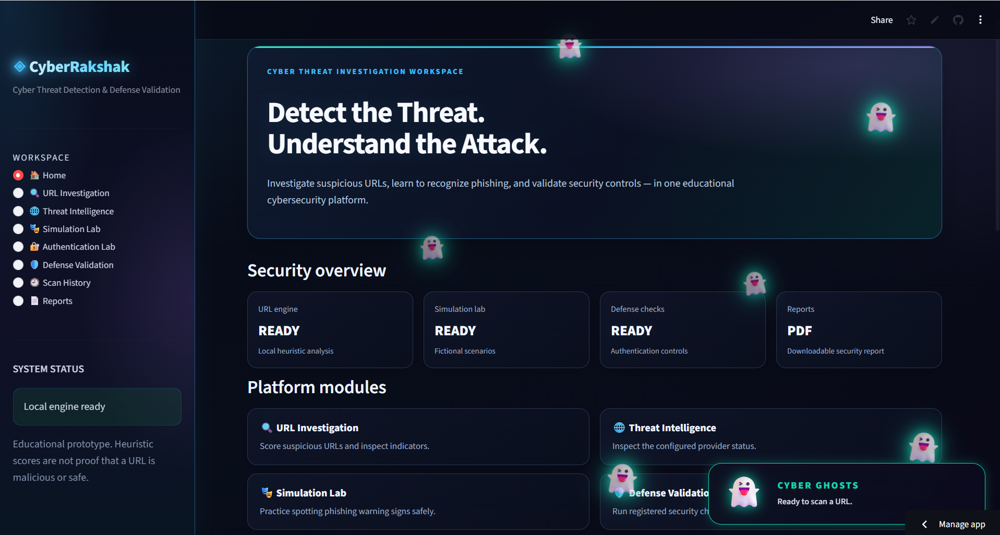

<div align="center">

# 🛡️ CyberRakshak

### Cyber Threat Detection & Defense Validation

**Investigate URLs. Inspect website security. Validate defensive checks.**

[](https://cyberrakshak-v2vbwuyfrezxekzmuaky3l.streamlit.app/)
[](https://www.python.org/)
[](https://streamlit.io/)

[**Live Application**](https://cyberrakshak-v2vbwuyfrezxekzmuaky3l.streamlit.app/) · [**GitHub Repository**](https://github.com/AadithyaBM/CyberRakshak)

</div>

---

## 📌 About the Project

**CyberRakshak** is a Python-based cybersecurity educational application built with Streamlit. It brings together URL investigation, website security inspection, threat-intelligence integration, security testing, and defensive validation in an interactive web interface.

The project was developed to gain practical experience in Python programming, cybersecurity concepts, web application development, automated testing, and cloud deployment.

> ⚠️ **Disclaimer:** CyberRakshak is an educational prototype. Heuristic risk scores are not proof that a website is safe or malicious.

## ✨ Key Features

| Feature                     | Description                                                                             |
| --------------------------- | --------------------------------------------------------------------------------------- |
| 🔍 **URL Investigation**    | Analyzes URLs using heuristic rules to identify potentially suspicious characteristics. |
| 🌐 **Website Inspection**   | Provides website analysis, including supported SSL/TLS, DNS, WHOIS, and HTML checks.    |
| 🛡️ **Threat Intelligence** | Supports online threat-intelligence checks when correctly configured.                   |
| 🔐 **Authentication Lab**   | Demonstrates authentication security concepts and implemented checks.                   |
| 🎭 **Phishing Simulation**  | Provides educational phishing-related scenarios.                                        |
| 🧪 **Defense Validation**   | Runs available defensive security validation checks.                                    |
| 📄 **Security Reports**     | Generates downloadable reports containing supported analysis results.                   |
| 📊 **Dashboard & History**  | Displays available dashboard information and recorded scan history.                     |

## 📸 Application Screenshots

### 1. 🏠 Dashboard

The main interface for accessing CyberRakshak's available security tools.



### 2. 🔍 URL Investigation

Demonstrates the URL analysis interface and its assessment results.


### 3. 🔐 SSL Certificate Inspection

Shows certificate verification information, hostname details, and TLS information.


### 4. 📄 Security Report

Demonstrates the application's report-generation feature.


---

## 🧰 Technology Stack

| Technology       | Purpose                           |
| ---------------- | --------------------------------- |
| **Python**       | Core application logic            |
| **Streamlit**    | Interactive web interface         |
| **Pandas**       | Tabular data processing           |
| **Requests**     | HTTP requests and API integration |
| **Plotly**       | Interactive visualizations        |
| **ReportLab**    | PDF report generation             |
| **dnspython**    | DNS inspection                    |
| **python-whois** | WHOIS information lookup          |
| **Pytest**       | Automated testing                 |

## 🏗️ Project Structure

```text
CyberRakshak/
├── app.py
├── engine/
│   ├── url_analyzer.py
│   ├── site_inspector.py
│   └── threat_intelligence.py
├── reports/
│   └── report_generator.py
├── security/
│   ├── auth_security.py
│   └── defense_validator.py
├── simulation/
│   └── phishing_simulator.py
├── tests/
├── screenshots/
│   ├── Dashboard.png
│   ├── URL Investigation.png
│   ├── SSL Certificate.png
│   └── Security Report.png
├── requirements.txt
├── .gitignore
└── README.md
```

*This is a representative structure. Refer to the repository for the complete and current file list.*

---

## ⚙️ Installation and Local Setup

### Prerequisites

* Python installed
* Git installed
* Terminal or command prompt

### Step 1: Clone the repository

```bash
git clone https://github.com/AadithyaBM/CyberRakshak.git
```

### Step 2: Navigate to the project directory

```bash
cd CyberRakshak
```

### Step 3: Create a virtual environment

```bash
python -m venv .venv
```

### Step 4: Activate the environment

**Windows PowerShell**

```powershell
.\.venv\Scripts\Activate.ps1
```

### Step 5: Install dependencies

```bash
python -m pip install -r requirements.txt
```

### Step 6: Launch CyberRakshak

```bash
python -m streamlit run app.py
```

Open the local address printed in your terminal to use the application.

---

## 🔑 Optional API Configuration

If you use the Google Safe Browsing integration, configure the API key securely.

**Windows PowerShell**

```powershell
$env:GOOGLE_SAFE_BROWSING_API_KEY = "YOUR_API_KEY"
```

Launch the application from the same terminal session.

For Streamlit Community Cloud, configure the key using the application's Secrets settings instead of hardcoding it into source files.

**Never commit API keys, passwords, or other secrets to GitHub.**

---

## 🧪 Testing

CyberRakshak includes automated tests for supported components.

To run the test suite locally, ensure that `pytest` is installed. If it is not included in the runtime dependencies, install it separately:

```bash
python -m pip install pytest
```

Run the tests:

```bash
python -m pytest
```

Review the output for passed and failed tests. Automated tests cover specific scenarios and do not guarantee that every possible security condition is detected.

## 🚀 Live Deployment

CyberRakshak is deployed using **Streamlit Community Cloud**.

<div align="center">

### 🌐 Try CyberRakshak

[](https://cyberrakshak-v2vbwuyfrezxekzmuaky3l.streamlit.app/)

[Launch the Live Application](https://cyberrakshak-v2vbwuyfrezxekzmuaky3l.streamlit.app/)

</div>

Source code and deployment configuration are maintained in the GitHub repository.

---

## ⚠️ Limitations

* Heuristic URL analysis can produce false positives and false negatives.
* A low risk score does not prove that a URL is safe.
* A high risk score does not independently prove that a URL is malicious.
* Threat-intelligence results depend on API configuration, provider availability, and returned data.
* Website inspections can be affected by DNS failures, network restrictions, timeouts, and remote server behavior.
* Local SQLite scan history may not persist reliably across hosting restarts or redeployments.
* The application is an educational prototype, not a replacement for professional security products or comprehensive security audits.

## 🔮 Future Improvements

Potential future enhancements include:

* 📈 Evaluate detection performance using labeled datasets.
* 🤖 Explore machine-learning-based URL classification.
* 📊 Measure precision, recall, F1-score, and false-positive rates.
* 🛡️ Expand threat-intelligence integrations.
* 🧪 Improve automated testing and edge-case coverage.
* 💾 Add reliable persistent storage for scan history.
* 🎨 Improve dashboard visualizations and report design.
* ♿ Improve accessibility and mobile responsiveness.
* ⚙️ Improve error handling and user feedback.

## 🔒 Responsible Use

CyberRakshak is intended for education and authorized security analysis.

* Inspect systems only when you have permission.
* Do not use the application for unauthorized security testing.
* Do not treat heuristic assessments as definitive security verdicts.
* Verify important security findings using appropriate trusted sources.

## 👨‍💻 Author

**Aadithya BM**

* **GitHub:** [AadithyaBM](https://github.com/AadithyaBM)
* **Project Repository:** [CyberRakshak](https://github.com/AadithyaBM/CyberRakshak)
* **Live Demo:** [CyberRakshak on Streamlit](https://cyberrakshak-v2vbwuyfrezxekzmuaky3l.streamlit.app/)

---

<div align="center">

**⭐ If you find CyberRakshak useful, consider starring the repository!**

*Built to explore Python development, cybersecurity analysis, software testing, and web application deployment.*

</div>
